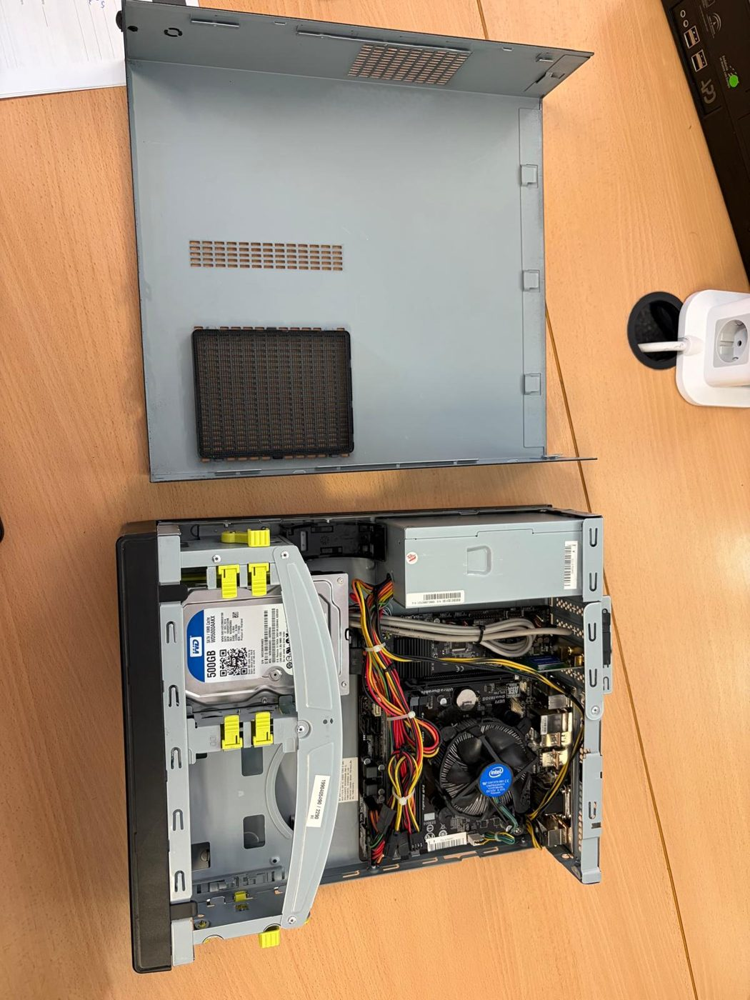
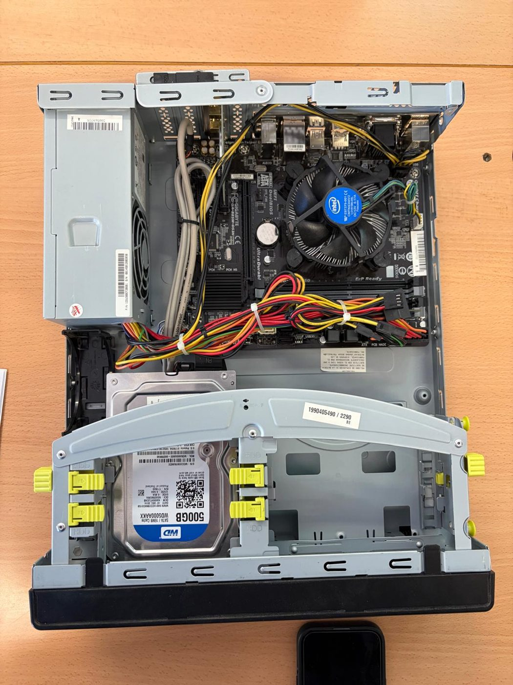
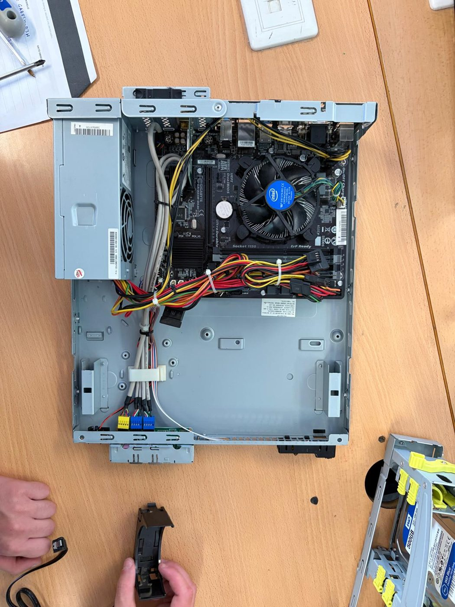
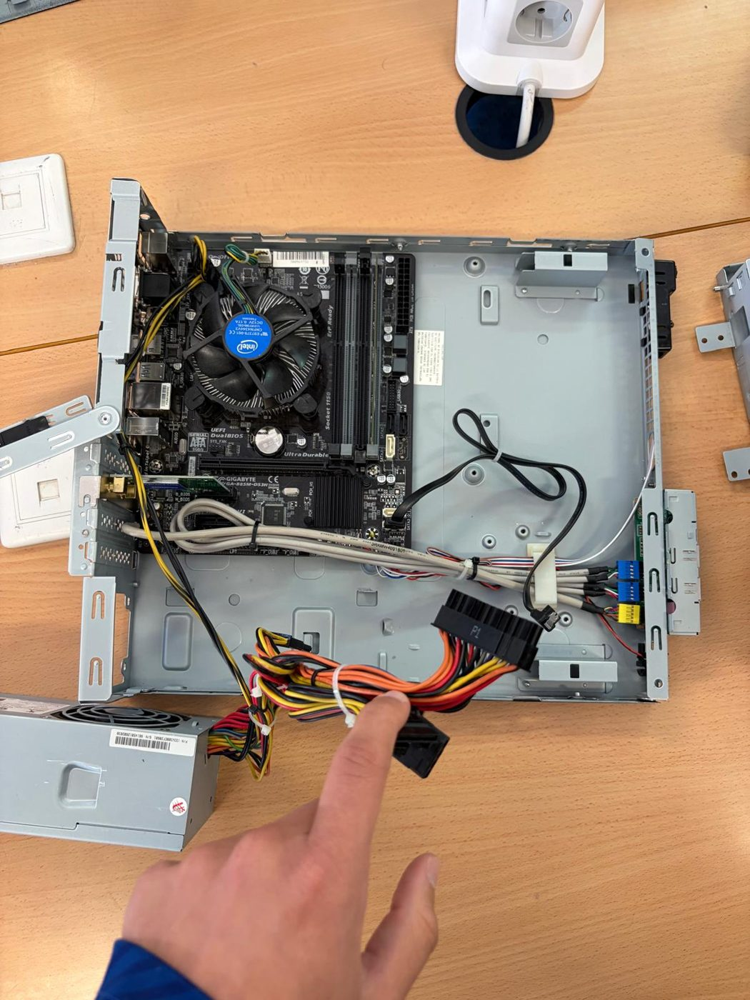
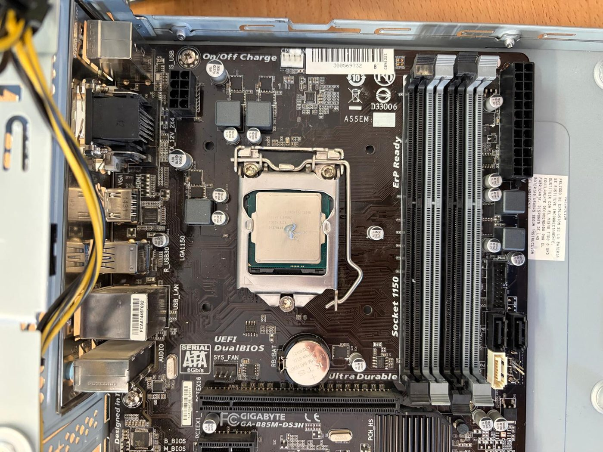
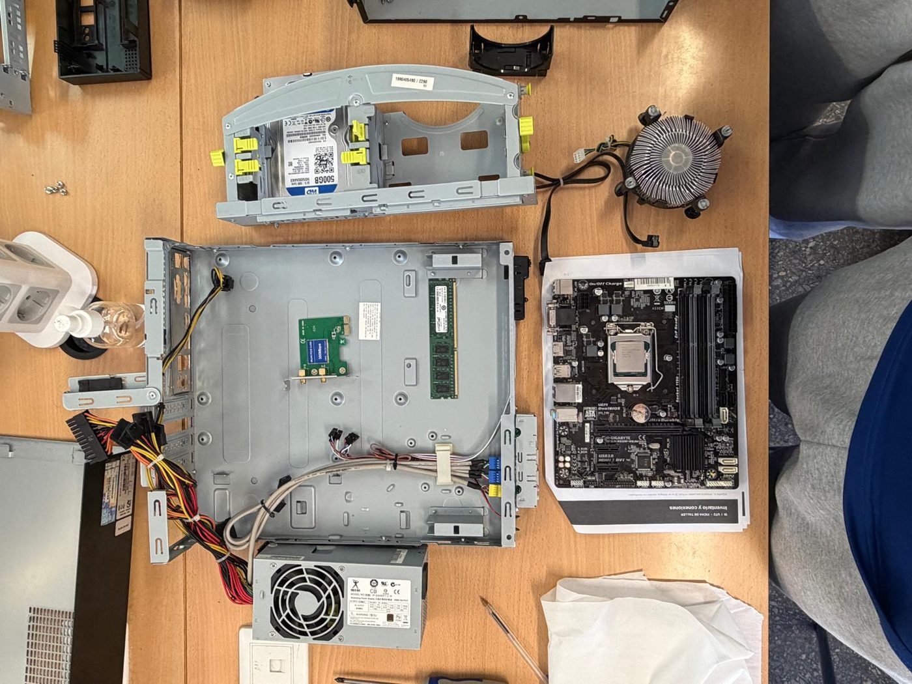
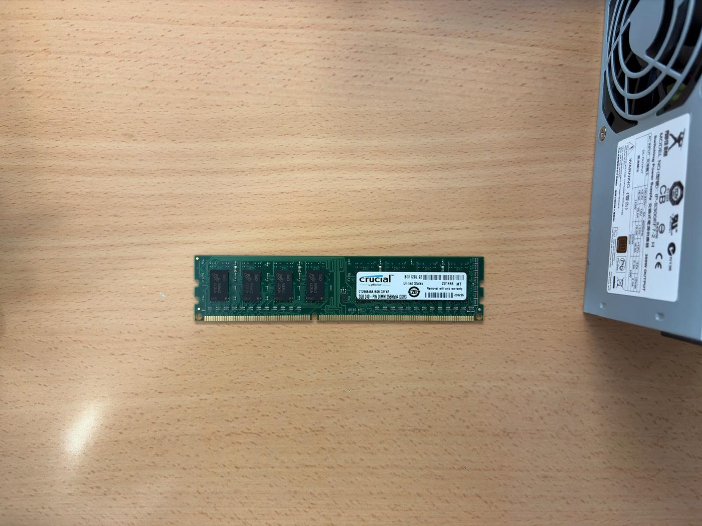
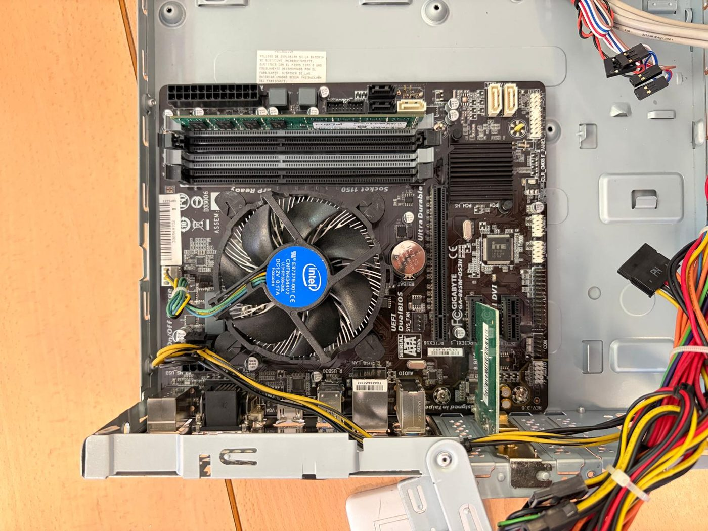
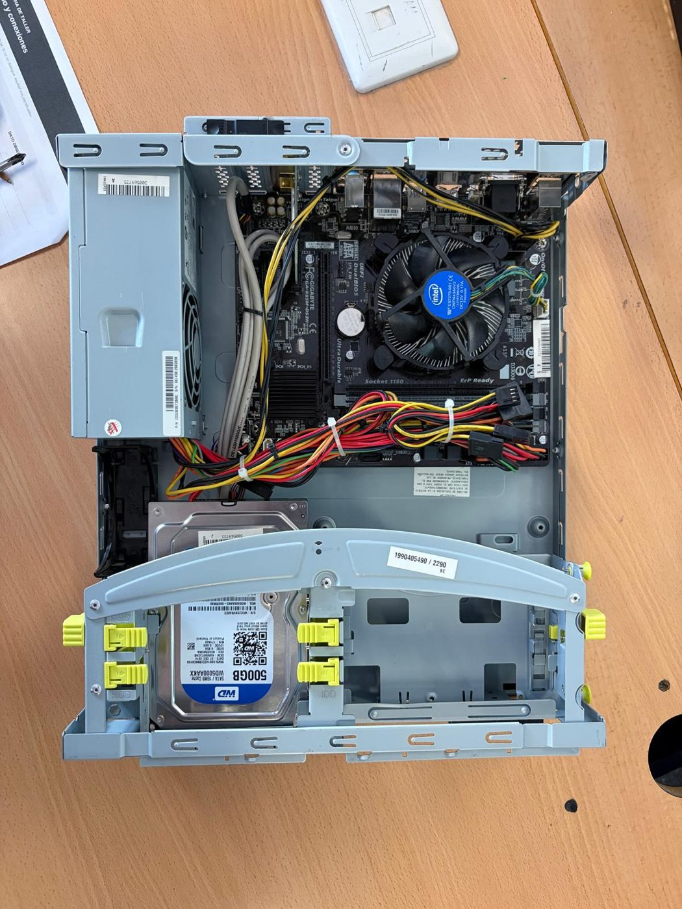

# SI · UT2 — Ficha de taller: montaje y revisión de un ordenador

## 1. Orden de trabajo

**Fecha:** lunes, 16/11/2026

**Integrantes del grupo:**

1. Nombre y apellidos: Saúl Ovalles
2. Nombre y apellidos: Javier Aranda

> **Equipo A:** ordenador de prácticas utilizado para el montaje o la revisión. Puede estar averiado; no se exige que arranque.
>
> **Equipo B:** vuestro propio ordenador funcional. Se utiliza a partir del apartado 9 para analizar el arranque y el hardware desde Linux.

## 2. Recepción e inspección visual · Equipo A

**Trabajo previsto:**

- [x] Desmontaje y montaje
- [ ] Revisión / diagnóstico
- [ ] Otro: ___________________________________

**Estado al recibirlo:**

- [x] Completo
- [ ] Faltan piezas
- [ ] Sucio
- [ ] Daños visibles

**Síntomas conocidos, piezas ausentes o daños observados:**

No vimos daños ni piezas que faltaran. Es un ordenador de sobremesa compacto con la bandeja de discos que se levanta con una palanca.

## 3. Seguridad y preparación · Equipo A

- [x] Equipo desconectado de la corriente y de los periféricos.
- [x] Botón de encendido pulsado tras desconectar.
- [x] Superficie despejada y piezas organizadas.
- [x] Estado inicial y conexiones fotografiados.

**Herramientas utilizadas:** destornillador de estrella.

**No abráis la fuente ni forcéis piezas.** Ante daños o baterías, avisad al profesor.

## 4. Componentes identificados · Equipo A

| Componente | Marca / modelo | Dato observado |
|---|---|---|
| Placa base | Gigabyte GA-B85M-DS3H (rev. 3.0) | Micro-ATX, socket LGA1150, 4 ranuras DDR3, UEFI DualBIOS, SATA 6 Gb/s |
| Procesador | Intel Celeron G1840 | 2,80 GHz, socket LGA1150 |
| RAM | Crucial CT25664BA160B | 1 módulo de 2 GB DDR3, 240 pines (DIMM) |
| Almacenamiento | Western Digital WD5000AAKX (WD Blue) | Disco duro de 500 GB, SATA, 16 MB de caché |
| Fuente | Modelo IP-S300EF7-2 H (marca no identificada) | 300 W |
| Disipador / ventilador | Intel E97379-001 (disipador de serie) | Ventilador de 12 V 0,17 A, conectado a CPU_FAN |
| Tarjetas / otros | Tarjeta de red wifi PCIe x1 (marca no identificada) | 300 Mbps, con 2 conectores de antena |

## 5. Conexiones y observaciones · Equipo A

Identificad y marcad las conexiones presentes y comprobadas:

- [x] Alimentación de la placa (conector de 24 pines)
- [x] Alimentación de la CPU (conector ATX 12 V)
- [x] Ventilador de la CPU (CPU_FAN)
- [x] Datos de almacenamiento (cable SATA)
- [x] Alimentación del disco (SATA de la fuente)
- [x] Panel frontal (botón, LEDs, USB y audio)

**¿Hay algún cable suelto, conector dañado o conexión que no sepáis identificar?**

No vimos conectores dañados. Lo que más nos costó fue saber dónde iba cada cable del panel frontal y volver a dejarlos igual que estaban.

**Fotografías de referencia (nombre de archivo o ubicación):**

Están en la carpeta `img/`:

| Foto | Qué se ve |
|---|---|
|  | `01-apertura.jpg`: equipo abierto con la tapa quitada |
|  | `02-estado-inicial.jpg`: estado inicial por dentro, antes de tocar nada |
|  | `03-sin-bandeja-discos.jpg`: quitada la bandeja del disco |
|  | `04-desconexion-cables.jpg`: desconectando el conector de 24 pines |
|  | `05-cpu-sin-disipador.jpg`: procesador Celeron G1840 sin el disipador |
|  | `06-piezas-desmontadas.jpg`: todas las piezas desmontadas y organizadas |
|  | `07-modulo-ram.jpg`: módulo de RAM Crucial de 2 GB DDR3 |
|  | `08-placa-montada-ram-y-tarjeta.jpg`: placa montada con la RAM y la tarjeta wifi |
|  | `09-montaje-final.jpg`: equipo montado otra vez |

No retiréis la CPU ni el disipador sin indicación del profesor. Si se retira el disipador, consultad sobre limpieza y pasta térmica antes de volver a instalarlo.

## 6. Registro del trabajo · Equipo A

| Operación | Hecho | N/P | Foto / observaciones |
|---|:---:|:---:|---|
| Apertura y fotos iniciales | ☒ | ☐ | 01, 02 |
| Desconexión y organización de cables | ☒ | ☐ | 04 |
| Desmontaje / montaje de memoria | ☒ | ☐ | 07, 08 |
| Revisión / montaje de almacenamiento | ☒ | ☐ | 03 |
| CPU y disipador, si se autoriza | ☒ | ☐ | 05: se quitó el disipador, la CPU se quedó en el socket |
| Tarjetas de expansión | ☒ | ☐ | 06, 08: tarjeta wifi PCIe x1 |
| Reconexión y orden de cables | ☒ | ☐ | 09 |
| Cierre y limpieza del puesto | ☒ | ☐ | |

## 7. Incidencia o reparación · Equipo A

**Problema encontrado / hipótesis** (si no hay, indicadlo):

No hubo ningún problema. Todo encajó bien y no faltaba ninguna pieza.

**Acción realizada y resultado observado:**

Desmontamos y volvimos a montar todo el equipo (bandeja del disco, cables, RAM, tarjeta wifi, disipador y placa). Al final todas las piezas quedaron sujetas y conectadas igual que al principio.

## 8. Comprobación final · Equipo A

- [x] Piezas sujetas.
- [x] RAM encajada.
- [x] Cables revisados.
- [x] Sin tornillos sueltos.
- [x] Ventilador de CPU conectado.
- [x] Puesto recogido.

**¿Encendido autorizado?** ☐ Sí  ☒ No

**Resultado / motivo:** No lo encendimos en el taller; la práctica era desmontarlo y volver a montarlo.

Una observación no demuestra por sí sola la causa de una avería.

---

## 9. Identificación y arranque · Equipo B

**Equipo:** ☒ Portátil  ☐ Sobremesa  ☐ Otro. Es un HP OmniBook X Flip 14.

**Linux:** ☐ Instalado directamente  ☒ Máquina virtual

**Sistema operativo y versión:** Ubuntu 26.04.1 LTS

**Si es virtual: sistema anfitrión y programa de virtualización:** Windows 11 como anfitrión, con WSL 2.

**¿Arranca con normalidad? ¿Qué observáis desde el encendido hasta el inicio?**

Sí, arranca normal. Al encender sale el logo de HP, luego carga Windows y llega a la pantalla de inicio de sesión sin errores. Después abro Ubuntu desde WSL y también inicia bien.

**¿Qué es el POST y en qué se diferencia de la UEFI y del sistema operativo?**

El POST es la prueba que hace el ordenador al encenderse para ver que el hardware básico (RAM, CPU, teclado...) funciona. La UEFI es el firmware de la placa: es la que hace ese POST y luego busca el disco para arrancar. El sistema operativo (Windows o Linux) es lo que se carga después.

**¿Habéis accedido a la UEFI o consultado información de ella? ¿Qué dato habéis visto?**

No, nunca he entrado en la UEFI. En los HP se entra pulsando F10 al encender, pero no lo he probado ni he cambiado nada.

## 10. Linux: procesador · `lscpu`

```text
Architecture:             x86_64
CPU op-mode(s):           32-bit, 64-bit
CPU(s):                   16
Vendor ID:                AuthenticAMD
Model name:               AMD Ryzen AI 7 350 w/ Radeon 860M
Thread(s) per core:       2
Core(s) per socket:       8
Socket(s):                1
Virtualization:           AMD-V
Hypervisor vendor:        Microsoft
Virtualization type:      full
L2 cache:                 8 MiB (8 instances)
L3 cache:                 16 MiB (1 instance)
```

He dejado solo las líneas importantes; la lista de *flags* y la de vulnerabilidades eran muy largas.

**Modelo / CPU presentada a Linux:** AMD Ryzen AI 7 350 w/ Radeon 860M

**Arquitectura:** x86_64  **CPU lógicas visibles:** 16 (8 núcleos × 2 hilos)

**¿Qué diferencia hay entre núcleo e hilo? ¿Qué podéis concluir de la salida?**

Un núcleo es una parte física del procesador que ejecuta instrucciones, y un hilo es cada tarea que puede llevar un núcleo a la vez. En mi salida pone 8 núcleos y 2 hilos por núcleo, por eso Linux ve 16 CPU. También sale `Hypervisor vendor: Microsoft`, o sea que Linux está corriendo en una máquina virtual (WSL).

## 11. Linux: memoria · `free -h`

```text
               total        used        free      shared  buff/cache   available
Mem:            15Gi       708Mi        13Gi       3.5Mi       892Mi        14Gi
Swap:          4.0Gi          0B       4.0Gi
```

**Memoria total:** 15 Gi  **Memoria disponible:** 14 Gi (libre: 13 Gi)

**¿Qué significa «disponible» y por qué puede diferir de «libre»?**

«Libre» es la RAM que no se usa para nada (13 Gi) y «disponible» es la que se puede usar para abrir programas nuevos, contando la caché (`buff/cache`) que Linux suelta si hace falta. Por eso la disponible (14 Gi) sale más alta. Los 15 Gi son la memoria que Windows le da a WSL, no tiene por qué ser toda la del portátil.

## 12. Linux: almacenamiento · `lsblk`

```text
NAME MAJ:MIN RM   SIZE RO TYPE MOUNTPOINTS
sda    8:0    0 356.9M  1 disk
sdb    8:16   0 159.4M  1 disk
sdc    8:32   0     4G  0 disk [SWAP]
sdd    8:48   0     1T  0 disk /mnt/wslg/distro
                               /
```

**Disco identificado:** `sdd`, de 1 TB. Es el disco virtual de WSL, no el SSD real del portátil. `sdc` es la swap de 4 GB y `sda`/`sdb` son discos pequeños de solo lectura que usa WSL.

**Partición y punto de montaje, si aparecen:** No salen particiones. `sdd` está montado directamente en `/`.

**Explicad la diferencia entre disco, partición y punto de montaje:**

El disco es el dispositivo físico donde se guardan los datos. Una partición es una parte en la que se divide el disco. El punto de montaje es la carpeta de Linux desde la que se accede a esa partición (por ejemplo `/`).

## 13. Linux: dispositivos · `lspci` y `lsusb`

Al principio `lspci` y `lsusb` no estaban instalados. Los instalé con `sudo apt install pciutils usbutils`.

```text
$ lspci
0ddb:00:00.0 3D controller: Microsoft Corporation Basic Render Driver
3f62:00:00.0 3D controller: Microsoft Corporation Device 008a
5582:00:00.0 SCSI storage controller: Red Hat, Inc. Virtio 1.0 console (rev 01)
d749:00:00.0 System peripheral: Red Hat, Inc. Virtio 1.0 file system (rev 01)

$ lsusb
(no muestra nada)
```

**Dispositivo 1 y función:** `3D controller: Microsoft Basic Render Driver`. Es la gráfica virtual que Windows le da a WSL.

**Dispositivo 2 y función:** `Virtio 1.0 file system (Red Hat)`. Sirve para compartir archivos entre Linux y Windows.

**¿Por qué podría no aparecer un componente físico o mostrarse de otra forma en una máquina virtual?**

Porque en una máquina virtual como WSL, Linux no ve el hardware real, ve lo que le da Windows. A mí `lspci` solo saca dispositivos virtuales (Microsoft y Virtio), `lsusb` no muestra nada y el disco sale como `sdd` de 1 TB, que es un disco virtual.

## 14. Duda técnica y uso crítico de IA

**Herramienta utilizada y fecha:** Claude (IA), 20/11/2026

**Pregunta planteada:**

¿Qué diferencia hay entre la memoria libre y la memoria disponible que sale en `free -h`?

**Respuesta resumida y afirmación concreta que decidisteis comprobar:**

Me dijo que «libre» es la RAM que no se está usando para nada, y que «disponible» es la que se puede usar para programas nuevos, contando también la caché que Linux libera si hace falta. Decidí comprobar si en mi equipo la disponible sale más alta que la libre.

**Fuente técnica o prueba utilizada y resultado:** confirmada

Lo comprobé con el manual (`man free`) y con mi salida de `free -h`: libre 13 Gi y disponible 14 Gi, así que la disponible es mayor.

## 15. Valoración y entrega

**¿Qué paso fue más difícil y cómo lo resolvisteis?**

Lo más difícil fue volver a montarlo todo y que quedara igual que antes, y conectar los cables con cuidado para no dañar ningún contacto. Lo resolvimos yendo despacio y mirando bien dónde iba cada cosa.

**¿Qué relación existe entre el montaje y la información de Linux? Recordad que son equipos distintos.**

En el taller vimos las piezas físicas (placa, RAM, disco, CPU) de un equipo del instituto. Con los comandos de Linux vemos esas mismas piezas en mi portátil, pero desde el sistema. Como uso WSL, algunos datos salen virtualizados.

**¿Qué haríais de otra manera en un próximo montaje?**

Comprobar mejor que cada conector queda bien encajado hasta el fondo antes de cerrar, pero sin forzarlo.

Antes de entregar:

- [x] Ficha completa.
- [x] Fotos identificadas.
- [x] Salidas de Linux revisadas.
